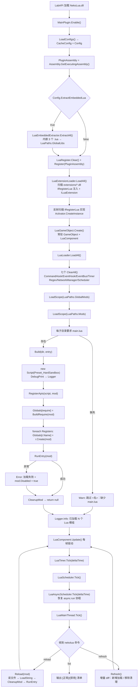
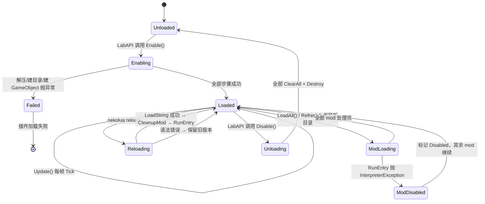
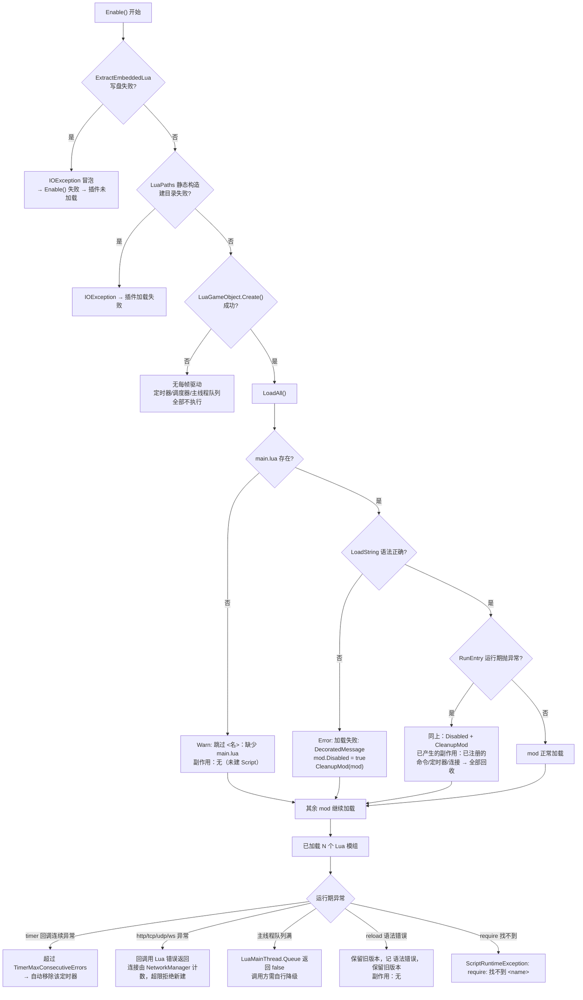

# NekoLua 流程图

- **项目路径**：`src/NekoLua/`
- **文档版本**：`v6`
- **最后同步**：2026-11-18 @ Astra 4.0 位置/传送接口接入
- **同步原因**：桥接为 `CustomItem` 增加 `astra.item`（define/give/find/list）并实现 `ISpawnOnRoundStart`，`spawn_points` / `max_spawn_count` 现在覆盖角色、波次与物品
- **负责人**：WorkBuddy（deepseek-v4.1-flash）

---

## 1. 端到端主流程

### 节点说明

| 节点 | 对应代码 | 说明 |
|---|---|---|
| `MainPlugin.Enable()` | `MainPlugin.cs` | 唯一启动入口，按固定顺序初始化；任一步抛异常则插件加载失败 |
| `LoadConfigs()` | `MainPlugin.cs` `LoadConfigs()` | 调 `base.LoadConfigs()`，随后把 `Config` 快照进 `CacheConfig`；运行期读配置一律用 `CacheConfig` |
| `LuaEmbeddedExtractor.ExtractAll()` | `Loader/LuaEmbeddedExtractor.cs` | 遍历 `GetManifestResourceNames()` 取 `NekoLua.EmbeddedLua.*.lua`，以 UTF-8 **无 BOM** 写入 `LuaPaths.GlobalLibs`；受 `ExtractEmbeddedLua` / `OverwriteEmbeddedLua` 门控 |
| `LuaRegister.Register()` | `Registers/LuaRegister.cs` | 反射扫描程序集内 `IRegisterLua` 实现并实例化；跳过 abstract / interface / 值类型 / 非 class；全局表名重复时拒绝注册 |
| `LuaExtensionLoader.LoadAll()` | `Loader/LuaExtensionLoader.cs` | 扫描 `LuaPaths.Extensions`（`NekoLua/extensions`）下的 DLL，实例化 `IRegisterLua`（新增全局表）与 `ILuaExtension`（OnLoad/OnUnload）；单个 DLL / 类型失败只记日志 |
| `LuaGameObject.Create()` | `Dependencies/LuaGameObject.cs` | 建常驻 `GameObject`（`NekoLua`）+ `LuaComponent`，`DontDestroyOnLoad`；**唯一每帧驱动点** |
| 七个 `ClearAll()` | `Loader/LuaLoader.cs` `LoadAll()` | 保证重载不残留旧钩子；顺序：CommandHook → EventHook → EventBus → Timer → Regex → NetworkManager → Scheduler |
| `LoadScope(GlobalMods)` / `LoadScope(Mods)` | `Loader/LuaLoader.cs` | 先全局后端口专属；目录不存在时先 `Create()` 再返回 |
| `Build(dir, entry)` | `Loader/LuaLoader.cs` | 建 `Script` → 建 `LuaModInstance` → `RegisterApis` → `RunEntry` |
| `RegisterApis` | `Loader/LuaLoader.cs` | 装 `require`，再把 73 张全局表逐张 `Create(mod)` 写入 `script.Globals`；其中静态入口类（`server` / `map` / `room` / `structure` / `hazard` / `respawn` / `pocket` / `scp914` / `permissions` / `reservedSlots` / `labapi` / `cassie`）由 `LuaTypeMapper.ScanStaticMethods` / `ScanStaticFields` 反射绑定 public 静态成员（自动跳过 `[Obsolete]` / 泛型定义 / `IsSpecialName`），写操作经 `GuardWrites`/`GuardCalls` 挂 `LuaGlobalApiGuard` 标签 |
| `BuildRequire(mod)` | `Loader/LuaLoader.cs` | 拒绝非字符串与含 `..` 的路径；候选顺序 = mod 目录 → `dependencies/<Port>` → `dependencies/global`；每候选做 `StartsWith(root)` 前缀校验 |
| `RunEntry(mod)` | `Loader/LuaLoader.cs` | 执行 `main.lua`；捕获 `InterpreterException` → 记 `加载失败: <DecoratedMessage>` 并置 `Disabled` |
| `LuaComponent.Update()` | `Dependencies/Components/LuaComponent.cs` | 每帧：`LuaTimer.Tick(deltaTime)` → `LuaScheduler.Tick()` → `LuaAsyncScheduler.Tick(deltaTime)` → `LuaMainThread.Tick()` |
| `Reload(mod)` | `Loader/LuaLoader.cs` | 只重读入口文件并 `LoadString`，**不重建 `Script`、不重跑 `RegisterApis`** |
| `Refresh()` | `Loader/LuaLoader.cs` | 增量 diff；已存在实例原样保留 |
| 命令分发 | `Commands/NekoLuaParentCommand.cs` | `nekolua` 父命令同时挂 `RemoteAdminCommandHandler` 与 `GameConsoleCommandHandler`，子命令 reload / list / refresh |

---

## 2. 生命周期与状态机

### 状态与资源

| 状态 | 进入动作 | 持有资源 | 退出动作（必须释放） |
|---|---|---|---|
| `Unloaded` | — | 无 | — |
| `Enabling` | `LoadConfigs` / 反射注册 / 建 GameObject / `LoadAll` | `CacheConfig`、`Registers` 实例、`NekoLua` GameObject、各 mod 的 `Script` 与全局表 | 中途失败由 LabAPI 走 `Disable()`；此时 GameObject 可能已创建 |
| `Loaded` | 记 `已加载 N 个 Lua 模组` | 全部 mod `Script` + 73 张表/mod + 定时器/调度器/事件/命令/连接 | 转入 `Unloading` |
| `ModLoading` | `Build` + `RegisterApis` + `RunEntry` | 新 `Script`、新表、可能已登记的定时器/连接 | 失败 → `CleanupMod` 回收 |
| `ModDisabled` | `RunEntry` 捕获异常，`mod.Disabled = true` | 该 mod 的 `Script`（保留但不再重载） | `CleanupMod(mod)` 已回收其钩子与连接 |
| `Reloading` | `File.ReadAllText` + `LoadString` | 同上 | 成功后 `CleanupMod` → `RunEntry`；语法错误则**不动**旧状态 |
| `Unloading` | `Disable()` | 同上 | 按序：`LuaRegister.Clear` → `LuaTimer.ClearAll` → `LuaEventHook.ClearAll` → `LuaCommandHook.ClearAll` → `LuaEventBus.ClearAll` → `LuaNetworkManager.ClearAll` → `LuaScheduler.ClearAll` → `LuaAsyncScheduler.ClearAll` → `LuaRegexProxy.ClearAll` → `LuaWin32Native.ClearAll` → `LuaMainThread.Clear` → `LuaLoader.ClearAll` → `LuaGameObject.Destroy` → `Instance = null!` / `PluginAssembly = null!` |

**关键约束**：`CleanupMod(mod)` 的回收顺序固定为 `LuaEventHook` → `LuaCommandHook` → `LuaEventBus` → `LuaRegexProxy` → `LuaNetworkManager` → `LuaTimer.CancelAll` → `LuaScheduler.CancelAll` → `LuaAsyncScheduler.CleanupFor` → `LuaCleanupRegistry`。新增任何「按 owner 持有资源」的子系统时，必须同时在这两处登记，否则热重载必然泄漏；扩展程序集则通过 `LuaCleanupRegistry.Register(mod, action)` 接入这条链（动作须可重复执行）。

---

## 3. 异常与回滚路径

### 失败点与处置

| 失败点 | 触发条件 | 已产生的副作用 | 补偿动作 | 是否可重试 |
|---|---|---|---|---|
| 内置库解压失败 | `GlobalLibs` 不可写、磁盘满 | 已解压的文件保留 | 修权限后重启；`OverwriteEmbeddedLua=false` 时只补缺失 | 是（重启） |
| 运行时目录创建失败 | `SecretLab` 不可写 | 无 | 修权限后重启 | 是（重启） |
| `LuaGameObject.Create()` 失败 | Unity 侧异常 | `Registers` 已注册、内置库已解压 | 重启；确认服务端 Unity 环境正常 | 是（重启） |
| mod 缺 `main.lua` | 目录内无入口文件 | 无（未建 `Script`） | 补文件后 `nekolua refresh` | 是（热） |
| `main.lua` 语法错误 | Lua 解析失败 | 无（`LoadString` 未成功） | 改文件后 `nekolua reload <名>` | 是（热） |
| `main.lua` 运行期异常 | 脚本逻辑错误 | 已注册的命令/定时器/事件/连接 | `CleanupMod` 已自动回收；改脚本后 `reload` | 是（热） |
| `require` 找不到模块 | 模块不在三个候选目录内 | 无 | 把库放进 mod 目录或 `dependencies/`；`refresh` | 是（热） |
| `require` 路径含 `..` | 越权访问 | 无 | 改用合法相对名 | 是（热） |
| `reload` 语法错误 | 改坏了入口文件 | 无（保留旧版本） | 修好后重新 `reload` | 是（热） |
| 定时器连续异常 | 回调持续抛错 | 该定时器仍在表内 | 超过阈值自动移除；脚本自行修 | 是（自动） |
| 序列化循环引用 / 深嵌套 | `json/yaml/xml.encode` 传入自包含 table 或超深结构（`meta.deepCopy`、`eventbus.emit`、`mod.registercfg` 同源） | 无 | 抛可捕获脚本异常（JSON 深度 128、YAML/XML 512、合并 64），不会 StackOverflow 崩进程 | 是（热） |
| 正则回溯爆炸 | 模式 + 输入使匹配超 1s（玩家输入可间接触发） | 无 | `MatchTimeout` 中止并抛脚本异常；`matchAll/findAll` 结果 > 10000 条同样中止 | 是（热） |
| 解压炸弹 | `gunzip/inflate` 输出 > 64MB | 无 | 配额中止并抛脚本异常 | 是（热） |
| HTTP 大响应 / 慢速滴流 | 远端返回 > 64MB 或无限速发送 | 请求失败 | 响应体配额 + 读取全程受 `HttpTimeoutSeconds` 约束，回 err 元组 | 是（热） |
| WS 大消息 | 远端发送单条 > 8MB 的分片消息 | 连接关闭 | onError + Dispose | 是（热） |
| TCP 对端停滞 | 对端停止接收时同步 `send` | 发送失败 | `SendTimeout` 5s 上限后 onError，不再无限冻结主线程 | 是（热） |
| UDP 灌包 | 对端持续以大报文灌包 | 丢包 | 每连接待处理 ≤ 8MB 按字节限幅 | 是（热） |
| FTP 数据流停滞 | 恶意 FTP 服务器慢速/停滞传输 | 操作失败 | `ReadWriteTimeout` 15s；目录列表 ≤ 4MB | 是（热） |
| `runSync` 子进程挂起 | 子进程不退出 | 无 | 30s 超时强制 Kill 并抛脚本异常 | 是（热） |
| 主线程队列溢出 | 入队速度 > `MainThreadTasksPerTick` × 帧率 | 入队失败 | 上调 `MainThreadQueueLimit` / `MainThreadTasksPerTick`；脚本侧削峰 | 是（配置） |
| 连接数超限 | 单 mod 连接 ≥ `MaxConnectionsPerMod` | 已开连接保留 | `LuaNetworkManager.TryRegister` 返回 `false`；关闭旧连接 | 是（热） |
| 路径被 `BlockedPaths` 拦截 | 访问系统目录 | 无 | 改用合法路径；确需则调配置 | 是（配置+重启） |
| 路径落在 mod 目录之外 | 绝对路径指向别的 mod / 服务端目录（含 `LuaPaths.Root`、`ServerRoot`、用户目录） | 无 | `LuaPathGuard.Resolve` 抛「只允许访问脚本自己的 mod 目录」；共享目录需登记 `AllowedPaths` | 是（配置+热） |
| `ftp:download/upload` 本地路径越界 | FTP 本地路径试图覆盖服务器文件 | 无 | 本地路径同样经 `LuaPathGuard`，越界直接抛脚本异常 | 是（热） |
| 网络目标命中私网/环回 | `http`/`tcp`/`udp`/`websocket` 指向本机、RFC1918、链路本地或云元数据 | 无 | `LuaNetworkGuard` 抛 `ScriptRuntimeException`；关掉 `BlockPrivateNetworkTargets` 可放行 | 是（配置+热） |
| `server.runCommand` 被禁用 | 未开 `AllowScriptRunCommand` 或命令不在 `RunCommandPrefixWhitelist` 前缀内 | 无 | 抛脚本异常；放行时写 `[NekoLua][audit]` 审计日志 | 是（配置+热） |
| 全服级 API 被标签禁用 | `DeniedGlobalApis` 命中（13 个标签：`warhead` / `round` / `server` / `whitelist` / `reservedSlots` / `permissions` / `broadcast` / `cassie` / `decontamination` / `map` / `hazard` / `pocket` / `scp914`） | 无 | `LuaGlobalApiGuard` 抛脚本异常（只读查询不受影响） | 是（配置+热） |
| Win32 函数命中黑名单 | `EnableWin32=true` 但函数属进程创建/内存读写/模块加载类 | 无 | `CheckWhitelist` 抛异常（黑名单优先于空白名单） | 是（配置+热） |
| Win32 指针实参被拒 | 传 `{type="ptr", value=…}` 且 `Win32AllowPointerArgs=false` | 无 | `LuaWin32Native.MapLuaToNative` 抛异常 | 是（配置+热） |
| SpeakerToy id 池耗尽 | 同一时刻存活 SpeakerToy ≥ 100 | 无 | 按存活实例求最小空闲 id；销毁即回收；全部占用时抛脚本异常 | 是（热） |

---

## 4. 外部依赖与边界

| 依赖 | 方向 | 调用位置 | 失败影响 | 降级策略 |
|---|---|---|---|---|
| SCP:SL 游戏程序集（`Assembly-CSharp` / `-firstpass` / `CommandSystem.Core` / `Mirror`） | 引用（编译期） | 全项目 | 编译失败 | 锚定 `libs/scpsl-server/current/`；**`CommandSystem.Core` 必须用非公开化版本**（见 playbook CS0507） |
| LabAPI（`Northwood.LabAPI` 1.1.7） | 引用（NuGet） | `MainPlugin`、`Commands`、`Proxies/GameContents` | 编译失败 / 运行时类型缺失 | 由 `Directory.Packages.props` 集中管理版本 |
| `LabApi-Publicized.dll` | 引用（预公开化） | `Proxies` 访问 internal 成员处 | 编译失败 | 锚定 `libs/PublicizedAssemblies/` |
| Unity（`UnityEngine` / `CoreModule` / `PhysicsModule` / `TextMeshPro`） | 引用 | `LuaGameObject`、`LuaComponent`、`LuaVector`、`UnityContents` | 编译失败 / GameObject 创建失败 | 锚定 `libs/unity/current/` |
| MoonSharp 2.0.0 | 引用（NuGet） | 全 `Loader` / `Proxies` | 无法运行任何 Lua | 版本在 CPM 登记；运行时需 DLL 可加载 |
| Newtonsoft.Json 13.0.4 | 引用（NuGet） | `LuaJson`、`LuaObjectProxy` | JSON 表不可用 | — |
| NVorbis 0.10.5 | 引用（NuGet） | `Proxies/SubLibs/LuaNvorbisProxy` | `nvorbis` 表不可用 | `Config.EnableNvorbis = false` 可关闭 |
| `System.Net.Http` 4.3.4 | 引用（NuGet） | `Proxies/Net/LuaHttpProxy` | `http` 表不可用 | — |
| AstraFramework（可选，仅 `NekoLua.Astra`） | 引用（编译期，`libs/astra/4.0.0/`） | `src/NekoLua.Astra/*` | 桥接 DLL 不加载 / `astra.available=false` | 核心不引用；扩展目录扫描失败只记日志 |
| 文件系统（`SecretLab/NekoLua`） | 双向（读写） | `LuaPaths`、`LuaEmbeddedExtractor`、`file`/`directory` 表 | 目录不可写则插件加载失败；运行期读写失败由脚本处理 | `LuaPathGuard` 双层（`BlockedPaths` 硬拒绝 + `AllowedPaths` 放行），默认只能访问自身 mod 目录；`ExtractEmbeddedLua=false` 跳过解压 |
| 网络（HTTP/TCP/UDP/WS/FTP） | 出向 | `Proxies/Net/*` | 连接失败由脚本处理 | `EnableNetwork` / `EnableFtp` 总开关；`MaxConnectionsPerMod` 限流；`BlockPrivateNetworkTargets` 阻断私网/环回/云元数据 |
| 操作系统进程与原生调用 | 出向（默认关） | `Proxies/Interop/*`、`LuaProcessProxy` | 主机被脚本控制 | `EnableProcess=false`、`EnableWin32=false` 默认关闭；`Win32FunctionBlacklist`（进程创建/内存读写/模块加载）硬拒绝、`Win32AllowPointerArgs=false`；`ProcessWhitelist` 支持全路径强模式 |

---

## 5. 同步记录

| 日期 | commit | 变更摘要 | 更新的图 |
|---|---|---|---|
| 2026-10-01 | `9ab6603` | NekoLua 首次入库，建立流程图基线 | §1 / §2 / §3 |
| 2026-10-01 | `agent/task-214`（基线 `7f6dcdd`） | 资源耗尽类修复：Update 链补 `LuaAsyncScheduler.Tick`；`CleanupMod`/`Disable` 清理链收口；新增序列化深度/循环引用、regex 超时、解压/响应体配额、TCP/FTP 超时、UDP 字节限幅、runSync 超时等宿主上限；连接计数修复后 `MaxConnectionsPerMod` 真实生效 | §1 / §2 / §3 |
| 2026-10-02 | `agent/task-212`（基线 `c84a906`） | 安全边界与授权类修复：`LuaPathGuard` 由系统目录黑名单改为「mod 作用域白名单 + `AllowedPaths`」；新增 `LuaNetworkGuard`（SSRF 私网/环回/元数据阻断）与 `LuaGlobalApiGuard`（全服 API 标签门禁）；`server.runCommand` 加 `AllowScriptRunCommand` + 前缀白名单 + 审计日志；`nekolua refresh` 补 `ServerConsoleCommands` 权限；命令失败文案改固定话术；Win32 加函数黑名单与指针实参拒绝；FTP 本地路径纳入 `LuaPathGuard`；SpeakerToy `controllerId` 改为动态分配 | §2 / §3 / §4 |
| 2026-10-02 | `agent/task-212`（基线 `c84a906`） | 完整支持 LabAPI：`LuaTypeMapper` 增加静态方法/常量声明式绑定与集合打包；新增 `room` / `structure` / `hazard` / `respawn` / `pocket` / `scp914` / `permissions` / `reservedSlots` 8 张表；升级 `labapi` / `cassie` / `server` / `player` / `door` / `map` / `broadcast` / `decontamination`；全局表 65 → 73，门禁标签 5 → 13，新增 `LuaArgs` / `LuaTableFactory` | §1 / §2 / §3 / §4 |
| 2026-11-14 | `0a00d81`（核心）+ `31c72ec`（桥接） | 新增扩展装载点：`extensions/*.dll` 扫描、`IRegisterLua` 注入、`ILuaExtension` 生命周期、`LuaCleanupRegistry` 回收链、`LuaEventHook.RegisterEventClass`；新增可选 `NekoLua.Astra` 桥接（Astra 2.2.1 实例注册） | §1 / §2 / §4 |
| 2026-11-14 | Astra 3.0.1 适配 | 桥接改用 Entry 模型：`ItemEntry` 初始物品（支持自定义物品 Id）、`TeamRef` 波次阵营（原版/自定义混编）、`RoleEntry` 刷新表；生成器实现 `ICustomWaveRoleSpawnerV2`；最低 Astra 版本 3.0.1 | §4 |
| 2026-11-14 | Astra 3.2.0 适配 | `astra.wave.define` 增加 `weight` / `min_players` / `max_players`（`LuaCustomWave` 实现 `IWeightedWave`，可被 `WaveScheduler` / `SupportWavePool` 使用）；最低 Astra 版本 3.2.0 | §4 |
| 2026-11-14 | Astra 3.3.1 适配 | 依赖升级 `libs/astra/3.3.1/`；修复 `CustomRole.RemoveRole` 守卫，`OnRemoved` 与角色属性回收恢复；桥接最低版本 3.3.1 | §4 |
| 2026-11-14 | `0672651` | 扩展装载改为 `Assembly.Load(byte[])`（不再锁定 DLL，覆盖后重启 / 重新启用生效）；扩展之间不保证程序集解析，不能依赖 `extensions/` 内其它 DLL | §2 / §4 |
| 2026-11-16 | Astra 4.0.0 适配 | 依赖升级 `libs/astra/4.0.0/`；桥接按 4.0.0 编译验证，最低版本 4.0.0 | §4 |
| 2026-11-16 | 桥接回合开始生成 | 角色/波次实现 `ISpawnOnRoundStart`，新增 `spawn_points` / `max_spawn_count` | §4 |
| 2026-11-16 | 物品刷怪点接入 | 新增 `astra.item`（define/give/find/list），物品实现 `ISpawnOnRoundStart`；注销顺序 角色→物品→波次→阵营 | §4 |
| 2026-11-18 | 位置/传送接入 | 新增 `astra.position.teleport(ply, spec)` / `resolve(spec)`，标签 `astra.position`；解析阶段随机选房 | §4 |

---

## 6. 同步触发清单

- [ ] 新增 / 删除模块或公开 API（含 Lua 全局表）
- [ ] 修改主链路步骤或分支条件
- [ ] 修改事件 / 命令 / 中间件 / 定时任务的注册与分发
- [ ] 修改状态机、生命周期或资源持有关系
- [ ] 修改错误处理与回滚路径
- [ ] 增删外部依赖或改变依赖边界

> 未同步流程图的 PR，视为 DoD 未完成（`AGENTS.md` §12）。
